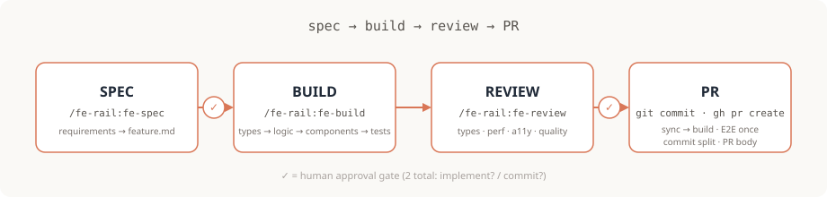

# fe-rail

<div align="right">
  <a href="README.ko.md"></a>
  <a href="README.md"></a>
  <a href="LICENSE"></a>
  <a href="https://github.com/sh5623/fe-rail/actions/workflows/eval.yml"></a>
  <a href="https://www.claudepluginhub.com/plugins/sh5623-fe-rail?ref=badge"></a>
</div>

> 프론트엔드 프로젝트 전용 Claude Code 플러그인
> spec → build → review → PR 자동화 워크플로우. Next.js App Router / Vite SPA(TanStack Router·React Router 7·8) + TypeScript, Tailwind v3/v4와 shadcn/ui를 지원합니다.

## 설치

```bash
claude

/plugin marketplace add sh5623/fe-rail
/plugin install fe-rail@fe-rail-market
```

> [self-improvement](https://github.com/sh5623/self-improvement)도 같이 쓴다면, 마켓 하나로 두 개 다 설치: [`sh5623/guardrail`](https://github.com/sh5623/guardrail).



## 사용 예시

```
$ claude
> /fe-rail:fe-spec

[fe-spec] 요구사항 분석 중... (fe-analyst, fe-architect)
✔ feature.md 생성 완료: 7개 섹션, 미해결 질문 3건 해소

다음 단계?
  ❯ 풀 자동 (추천): fe-start 파이프라인으로 자동 연결
    구현만: 스펙 먼저 검토
    스펙 수정

> 풀 자동

[fe-start] Phase 2: 타입 → 훅 → 컴포넌트 → 테스트 구현 중
✔ 12개 파일 생성, tsc 통과, lint 통과, 테스트 8개 통과

커밋하고 PR을 열까요?
  ❯ 예: base 동기화 → 빌드·E2E 1회 → type별로 분리 커밋 → 드래프트 PR 생성
    아니오: 변경사항만 남기고 종료

> 예

✔ origin/main 동기화(상류 커밋 2개) · 빌드 통과 · E2E 통과
✔ 커밋 2개 생성
✔ feat/product-search-autocomplete 브랜치로 푸시
✔ 드래프트 PR: https://github.com/you/your-app/pull/42
```

사람이 개입하는 지점은 "구현할까요?"와 "커밋할까요?" 두 번입니다. 나머지는 전부 자동으로 진행됩니다.

## 포함된 스킬

| 스킬 | 명령어 | 설명 |
|------|--------|------|
| fe-spec | `/fe-rail:fe-spec` | 기능 요구사항 → 구조화된 스펙 문서 생성. Phase 3 에서 다음 단계(풀 자동·구현만·스펙 수정)를 라디오 UI로 선택하고, "풀 자동"을 고르면 fe-start 파이프라인으로 자동 연결 |
| fe-build | `/fe-rail:fe-build` | 프론트엔드 코드 구현 (기본 순서 타입→로직 분리→컴포넌트→테스트 · 레포의 기존 순서나 TDD 가 있으면 그것을 따름) |
| fe-review | `/fe-rail:fe-review` | 타입·성능·a11y·품질 4축 리뷰 |
| fe-start | `/fe-rail:fe-start feature.md` | 위 3개를 하나로 묶어 PR까지 자동화. Phase 1과 5가 라디오 UI로 진행 여부·커밋 방식 확인 |
| fe-doc-sync | `/fe-rail:fe-doc-sync` | **설치된 사용자 프로젝트** 스캔 (라우트·의존성·구조·ENV) → 그 프로젝트의 CLAUDE.md·README.md 수정안 제안 |

## 포함된 Hooks

정책: 위험은 차단(exit 2), 품질은 경고(stderr).

| Hook | 이벤트 | 역할 | 차단 |
|------|--------|------|------|
| `session-init.sh` | SessionStart | 원격 버전 체크 + 새 버전 알림 (GitHub, 하루 1회 · `FE_RAIL_NO_UPDATE_CHECK=1` 로 끔) | — |
| `guard.sh` | PreToolUse:Bash | `git add .`, force push, `--no-verify`, `rm -rf /`, `DROP TABLE`, `git reset --hard`, `git checkout/restore .` 등 차단. git 전역 옵션(`git -C <dir> …`·`-c k=v`·`--git-dir`)을 먼저 정규화하고 셸 래핑(`bash -c "git commit --no-verify …"`)도 잡는다. 커밋 검사는 셸처럼 읽는 작은 파서로 한다 — 따옴표 밖의 `;`·`|`·`&`·줄바꿈으로 명령을 나누고(리다이렉션 `2>&1` 은 제외) 따옴표를 걷은 낱말을 git 처럼 읽어, 짧은 플래그 묶음에 `n` 이 있거나(`-nm`·`"-n"`) `--no-verify`(축약 포함)면 막는다. 메시지 같은 옵션 값은 보지 않고, 인수 자리에 파서가 풀 수 없는 확장(`$X`·`$'…'`·백틱·`{…}`·글롭)이 오면 막는다(모르면 막는다). `-n` 없이 훅을 끄는 설정(`-c core.hooksPath` · `alias.*` · `include.path`, `GIT_CONFIG_*` 환경변수, `git config` 로 그 키에 값 쓰기)도 막는다. git 호출의 `--` 앞에 따옴표 없는 변수·명령 치환이 오면(낱말로 쪼개진다) 막고, 막을 때 이유를 알린다. 흔한 형태에 대한 백스톱이지 임의 셸 전체의 보장은 아니다 — 하위 명령까지 변수로 부른 git(`$G $SUB`), 큰따옴표 안 `$(…)` 속 따옴표 중첩, `HOME`·`GIT_DIR` 등으로 설정 파일 바꾸기, `.git/config`·`.git/hooks` 직접 수정은 보지 않는다. heredoc 커밋 메시지 본문도 명령으로 읽어, 본문에 우회 꼴이 글로 있으면 막힌다(`-F 파일`로). 보장 범위는 실제 실행 명령을 정적으로 식별할 수 있는 git 호출까지다 — 변수나 래퍼를 거쳐 식별할 수 없는 경우(`C=$(echo git commit); $C -n` · `bash -c "$G commit -n"`)는 범위 밖이고, 일부러 구성한 새 표현만으로는 파서를 넓히지 않으며 실제 사용 중 놓친 git 호출이나 막힌 정상 작업이 생기면 다시 검토한다 | ✅ |
| `write-guard.sh` | PreToolUse:Write\|Edit\|MultiEdit | `.env*`·인증서(`*.pem`/`*.key` 등)·시크릿 페이로드 파일(`*.secret`·`*credentials*.json` 등) 생성·수정 차단 (`.env.example`·`CredentialForm.tsx` 같은 소스 파일은 허용) | ✅ |
| `config-protection.sh` | PreToolUse:Write\|Edit\|MultiEdit | 린터/포매터/TS 설정 **약화** 편집만 차단: `strict:false`·`@ts-nocheck`·린터 `recommended:false`·기존 `strict:true` 제거. 편집 조각이 아니라 실파일의 편집 전 ↔ 후 전체(디스크 내용 + Edit/MultiEdit/Write 페이로드로 재구성)를 비교하므로, 값만 바꾸는 `true → false` Edit 과 `strict` 키를 뺀 Write 도 잡는다. 경로 alias·플러그인 추가 등 정상 편집은 통과 | ✅ |
| `read-guard.sh` | PreToolUse:Read | 민감 파일 읽기 시도 경고 출력 (`.env*`·`.envrc`, `*.pem`/`*.key`/`id_rsa` 등 키, `.npmrc`·`*credential*`. 목록은 write-guard 차단 목록과 대칭) | — |
| `task-guard.sh` | PreToolUse:Task\|Agent | 서브에이전트 프롬프트 내 인젝션 패턴·위험 명령 위임 차단 | ✅ |
| `lint-fix.sh` | PostToolUse:Edit\|Write\|MultiEdit | 소비자 환경 감지 → Biome `check --write` **또는** ESLint `--fix`(+Prettier) 자동 적용. 설정·바이너리는 파일에서 가장 가까운 `package.json`(모노레포 앱 로컬 설정) 기준으로 찾고 바이너리는 root-hoisted 도 탐색 (로컬 바이너리 우선, npx 폴백은 `FE_RAIL_ALLOW_NPX=1` 옵트인) | — |
| `nextjs-guard.sh` | PostToolUse:Edit\|Write\|MultiEdit | App Router 프로젝트(`app/` 존재, Pages Router 는 건너뜀)에서 `'use client'` 없는 파일의 React 훅/브라우저 API/DOM 이벤트를 «import 경계 확인 필요» 로 안내(클라이언트 경계 아래에서만 import 되는 자식은 지시어 불필요, 확정 근거는 `next build`), `page`/`layout`의 `'use client'` 경고 | — |
| `design-nudge.sh` | PostToolUse:Edit\|Write\|MultiEdit | 프론트 편집에 제네릭/템플릿틱(AI slop) 신호(무거운·임의 그림자, 기본 보라/인디고 그라디언트) 감지 시 경고. DESIGN.md 가 있으면 침묵한다(fe-reviewer 의 DESIGN Bans 가 정본) | — |
| `quality-gate.sh` | Stop | 변경 파일에 린터(Biome **또는** ESLint) + 타입체크를 실행하고 경고를 출력한다. 타입체크는 프로젝트 `typecheck` 스크립트를 우선하고(루트 `tsconfig.json` 이 없어도 실행), 솔루션 tsconfig면 `tsc -b`로 폴백한다. 변경 파일을 가장 가까운 `package.json` 별로 묶어 패키지마다 그 설정으로 검사(모노레포), 바이너리는 앱 로컬 → root-hoisted 순. 타입체크는 종료코드로 판정(성공 배너 오탐 없음). `tsconfig*.json`/`package.json` 변경과 소스 삭제도 트리거이며, 검사 범위를 조용히 자르지 않는다(상한 200, 초과분은 미검사로 명시) | — |
| `doc-sync-check.sh` | Stop | 사용자 프로젝트의 코드(src/app/pages/components 등)·package.json·설정 파일 변경 감지 시 `/fe-rail:fe-doc-sync` 실행 안내 (최근 커밋 5개 포함) | — |
| `test-verify-turn.sh` | UserPromptSubmit | 턴 시작 상태(HEAD + 미커밋 파일별 내용 해시)를 세션별로 `.git` 안에 기록한다(추적 안 됨). 출력 없음 | — |
| `test-verify-stop.sh` | Stop | 두 갈래를 본다. ① 이번 턴에 단위 테스트를 바꾸고 관련 제품 소스도 바뀌었는데, 그 테스트가 **수정 전 코드에서 실제로 실패하는지** 확인한 기록이 없음 ② `/fe-start` 여부 · 테스트 수정 여부와 무관하게, 이번 턴에 바뀐 **제품 코드(JS·TS)** 중 **실제로 대조한 기록이 없는 파일**이 있음. 둘 중 하나면 종료를 한 번 막고 파일마다 후보 테스트와 절차(`verify-test base` · `mutate` → `report`)를 지시한다. 마지막 답변에 `테스트 확인: 생략 — <이유>` 가 있으면 막지 않는다. 판단할 수 없거나(러너 · 적용 관계를 모름) 검증되지 않은 조합이면 막지 않는다. 아래 «회귀 테스트 확인» 참조 | 한 번 |
| `notify.sh` | (옵션) Notification | macOS terminal-notifier 배너 알림. `bash hooks/scripts/setup-notifier.sh` 로 활성화 | — |

### 훅 프로파일 · 토글 (강도 조절)

훅 강도를 환경변수로 조절할 수 있습니다. 플러그인 파일을 수정할 필요 없이 소비자 프로젝트의 셸이나 `.claude` 환경에서 설정합니다.

| 환경변수 | 값 | 효과 |
|---|---|---|
| `FE_RAIL_HOOK_PROFILE` | `minimal` | 비가역 위험 차단기만 (`guard`·`write-guard`·`task-guard`·`config-protection`). 품질 경고·자동정리·문서동기화 안내는 끔 |
| | `standard` (기본) | 위 + 품질 경고·자동정리·문서동기화 전부 |
| | `strict` | `standard` 상위 티어(현재는 상위집합, 향후 더 엄격한 동작 예약) |
| `FE_RAIL_DISABLED_HOOKS` | `"a,b"` | 특정 훅만 콕 집어 비활성 (예: `"doc-sync-check,design-nudge"`) |
| `FE_RAIL_ALLOW_NPX` | `1` | 로컬 린터·`tsc` 바이너리가 없을 때 npx 폴백 허용. 기본은 로컬 전용이라 자동 훅이 네트워크 다운로드나 미고정 최신버전 실행을 하지 않는다. 프로젝트 자체 `typecheck` 스크립트는 패키지 매니저로 실행되므로 이 옵트인과 무관하게 항상 허용 |
| `FE_RAIL_ALLOW_PW_INSTALL` | `1` | fe-start Phase 6-0(커밋 직전) 게이트가 Playwright 브라우저를 자동 설치(`playwright install --with-deps chromium`)하도록 허용. 기본은 꺼짐이다. 수백 MB 다운로드에 `--with-deps` 는 root 권한을 요구하므로 무인 파이프라인이 무통보로 유발하지 않게 한다. 꺼진 상태에서 브라우저가 없으면 E2E 는 통과가 아니라 "미실행(브라우저 미설치)" 로 정직하게 보고한다 |
| `FE_RAIL_NO_UPDATE_CHECK` | `1` | 세션 시작의 원격 버전 확인을 끈다(조회도 안내도 하지 않음). 외부 조회를 막아야 하는 사내망·오프라인 환경용 |
| `FE_RAIL_SKIP_SETUP_NUDGE` | `1` | 권장 Bash 권한이 없을 때 세션 시작에 나오는 1회 안내를 끈다 |

> 프로파일을 `minimal`로 낮춰도 안전 차단기는 꺼지지 않습니다. 차단기를 끄려면 `FE_RAIL_DISABLED_HOOKS` 에 이름을 명시해야 합니다(타협 없는 차단에 명시적 탈출구를 더한 구조). 세션 시작 시 기본이 아닌 프로파일/비활성 목록이 있으면 안내됩니다.
> 회귀 테스트 확인 훅 두 개는 같은 이름 `test-verify` 로 끕니다(`FE_RAIL_DISABLED_HOOKS="test-verify"`). 상한 · 시간 조정 변수(`FE_RAIL_VERIFY_*`)는 [`docs/test-verify.md`](docs/test-verify.md) §7 에 있습니다.

## 회귀 테스트 확인 (test-verify)

**이번 수정으로 보장하려는 동작을 일부러 깨뜨렸을 때, 그 동작을 지키는 테스트가 실제로 실패하는가**를 잽니다. 통과하는 테스트가 그 동작을 정말 지키는지는 다시 돌려서는 알 수 없습니다. 고친 줄을 되돌리거나 조건 하나를 깨뜨렸을 때 빨개져야 합니다. 테스트를 새로 썼는지는 상관없습니다. 제품 코드만 고치고 기존 테스트를 그대로 둔 경우에도 그 테스트가 이번 회귀를 잡는지 확인합니다. 이 플러그인은 그 «깨뜨리기» 를 사람이나 모델이 작업 트리에서 손으로 하지 않게 합니다.

```bash
fe-rail verify-test base -- src/price.test.ts                                   # 수정 전 대조(기준 = 이 세션의 턴 시작 HEAD)
fe-rail verify-test base --test "price > 부가세를 더한다" -- src/price.test.ts     # 대상 케이스 지정(손대지 않은 기존 테스트도 이렇게)
fe-rail verify-test mutate --file src/submit.ts --find "if (pending) return" --replace "" \
  --test "제출 > 처리 중 다시 눌러도 요청은 한 번" --intent "중복 제출 가드 제거" -- src/submit.test.tsx   # 지정 변이(새 기능 · 섞인 수정)
fe-rail verify-test status -- src/price.test.ts                                 # 바뀐 테스트를 덮는 기록이 있는가
fe-rail verify-test report                                                      # 이번 턴에 바뀐 제품 코드마다 «깨뜨린 동작 → 케이스 → 관측값 → 판정» 또는 «미실행»
```

- **격리본에서만 바꿉니다.** 현재 작업 내용(추적 + 무시되지 않은 미추적 파일)을 임시 폴더에 복사하고 `node_modules` 는 링크로 이어 붙인 뒤, 그 격리본을 그대로 복제해 둘을 만듭니다. 하나는 현재 소스, 하나는 제품 소스만 수정 전 내용(또는 변이)으로 바꿔 같은 테스트를 돌립니다. 사용자 작업 트리와 스테이징은 읽기만 합니다.
- **케이스마다 판정합니다.** 검출(현재 통과 · 대조에서 그 케이스의 본문 단언이 뒤집힘) · 미검출 · 원인 미확인(준비 단계 실패 · 단언이 아닌 오류 · 실패 위치를 가를 수 없음) · 측정 불가(격리 실패 · 현재 소스에서 실패 · 파일 로딩 실패 · 기준 스냅샷 없음 등). 확인하지 못한 결과는 검출로 세지 않습니다.
- **자동으로 돕니다.** 종료 훅은 이번 턴에 바뀐 단위 테스트를 수정 전 코드에서 확인한 기록이 없거나, 이번 턴에 바뀐 제품 코드(JS·TS)를 실제로 대조한 기록이 없으면 한 번 막고 절차를 지시합니다. `/fe-start` 없이 일반 세션에서 제품 코드만 고친 경우도 포함합니다. 기록은 **파일 단위로** 봅니다. `guard.ts` 와 `price.ts` 를 함께 고치고 가드 변이만 돌렸다면 `guard.ts` 만 확인한 것입니다. `--intent` 는 사람이 읽을 설명일 뿐 판정에 쓰지 않습니다. 동작 변화가 없거나(문구 · 표현 · 타입) 작업 중이면 답변 마지막 줄에 `테스트 확인: 생략 — <이유>` 를 적어 마칩니다. 완료 답변에는 `fe-rail verify-test report` 줄을 싣습니다. 실행하지 않은 파일은 «미실행», 실행했는데 잡지 못하면 «미검출» 과 그 케이스가 나옵니다. `fe-start` 는 Phase 4.5 에서 같은 판정으로 기록을 보고 결과를 PR `## 테스트` 에 싣습니다. `fe-test-author` 의 `regression` 모드, `fe-reviewer` 의 «테스트 판별력» 축도 이 기록을 씁니다.
- **자동 차단은 검증된 조합에서만** 켭니다. 고정 버전 fixture 로 실제 러너를 돌리는 eval(`node eval/runner.mjs`)을 통과한 조합입니다: npm · pnpm + Vitest 4 · 5, npm + Jest 30. 그 밖의 조합에서도 실행기는 직접 부를 수 있고 훅은 알림만 냅니다. Yarn PnP 는 첫 릴리스에서 지원하지 않습니다.
- **프로젝트 조정**: `package.json` 의 `"fe-rail": { "testVerify": { … } }` 로 테스트 명령(`command`) · 준비 명령(`prepare` — 빌드 결과물을 소비하는 워크스페이스용) · 격리본에 더 넣을 무시 파일(`copy`) · 분류 경로를 선언합니다.

판정 기준, 격리 자기 점검, 기록 재사용 · 파일 단위 덮임 조건, 지원 상태, 미검출 · 원인 미확인을 읽는 법, 변경에서 변이 고르기(가드 제거 · 경계값 · 분기 목적지 예시)는 [`docs/test-verify.md`](docs/test-verify.md) 에 있습니다. `fe-rail` 명령은 Claude Code 의 Bash 도구 PATH 에 오릅니다. 일반 셸 · CI 에서는 `node <설치 경로>/bin/fe-rail.mjs …` 로 부릅니다.


### 회귀 eval

```bash
bash eval/run.sh   # 실패 시 exit 1 (CI 용)
```

라이브 모델 없이 결정적으로 검증합니다.

- 훅 동작: fixture 를 주입해 exit code 와 경고를 단언한다. 차단 사유가 stdout 이 아닌 stderr 로 전달되는지, 비차단 훅 5개의 안내도 stderr 로 나가는지 포함
- 프로파일 토글
- 플러그인 self-lint: agent `model` 값이 유효 범위(별칭 `opus`/`sonnet`/`haiku`/`fable`/`inherit` 또는 전체 모델 ID) 안인지, agent `effort` 값이 설정된 경우 `low`/`medium`/`high`/`xhigh`/`max` 안이고 `haiku`(미지원)에는 설정돼 있지 않은지, skill frontmatter, frontmatter 평문 스칼라의 YAML 안전성(값에 `: `(콜론+공백) 등이 들어가면 파싱이 실패해 `tools`·`disallowedTools`·`model` 이 전부 조용히 드롭된다), `hooks.json` 무결성과 프로파일 배선, 위임을 지시하는 스킬의 `allowed-tools`에 Task/Agent 포함 여부, bun `PX` 감지 일관성, `typecheck` 분기의 `references`(tsc -b) 폴백 동반 여부, 바이너리+플래그 실행이 `$PM exec` 아닌 `$PX`인지
- fe-start 기본 게이트 명령 선택기(`gate-commands.mjs`): 실제 소비 프로젝트 꼴(단일 앱·하위 폴더 설정·워크스페이스 합본·`"workspaces": ["e2e"]` 같은 함정 값·bun 등)의 fixture 14개로 고른 명령을 고정한다(node 필요)
- session-init 버전 확인: `curl` 를 목으로 바꿔 새 버전 안내 · `FE_RAIL_NO_UPDATE_CHECK` 무소음 · 같은 버전 무소음 · 플러그인 경로가 없어도 뒤 안내 유지를 단언한다
- 회귀 테스트 확인(H 절 · `eval/test-verify.mjs`): 가짜 러너 fixture 로 분류 · 격리 실행(작업 트리 · 스테이징 보존, 실행 도중의 동시 스테이징) · 판정 · 기록 재사용 · 훅의 막기/침묵을, 실제 Vitest 4.1.9 · Jest 30.2.0 보고서 견본으로 판정 경계를 고정한다(의존성 설치 없음). 제품 코드 갈래(v1.22.0)는 테스트를 안 고친 턴의 차단 · 스타일 · 데이터 · 타입 선언만 바뀐 턴의 침묵 · 파일 단위 덮임(한 파일만 변이한 기록은 다른 파일을 덮지 않음 · `--intent` 무관 · `--only` 부분 덮임 · 실행 뒤 수정하면 무효 · «대상 케이스 없음» 은 덮지 않음) · 생략 줄 인식 · `report` 줄 형식을 고정한다
- 실제 러너(`node eval/runner.mjs` · 네트워크 필요): 검증된 조합마다 위 경계에 더해 «제품 코드만 고치고 기존 테스트는 손대지 않은 턴» 을 실제 러너로 돈다 — 훅 차단 · 기존 케이스 지정 수정 전 대조와 가드 제거 변이가 요청 횟수 단언(기대 1 · 실제 2)으로 검출 · `report` 한 줄

별칭 티어가 모델 업데이트로 바뀌거나 훅과 설정을 고칠 때 회귀를 잡는 용도입니다.

실제 러너 eval 은 따로 돕니다. 검증된 조합마다 고정 버전을 설치해 실제로 돌리므로 네트워크가 필요하고 2~3분 걸립니다. CI 가 푸시마다 돌립니다.

```bash
node eval/runner.mjs                      # 검증된 조합 전부(npm·pnpm × Vitest 4.1.9·5.1.0, npm × Jest 30.2.0) — 도구가 없으면 실패
node eval/runner.mjs --only npm-vitest-4  # 한 조합만
```

v1.17.0 에 F 절이 추가됐습니다. v1.16.2 에 대한 교차 레포 리뷰가 임시 저장소에서 지적 12개를 재현했고, 그 각각이 이제 회귀로 고정돼 있습니다: git 전역 옵션·셸 래핑이 차단기에 닿는지, 설정 보호가 실파일 전 ↔ 후로 판정하는지, `hooks.json` 의 모든 command 를 공백 포함 설치 경로에서 실제 실행, 모노레포 앱 로컬·root-hoisted 도구가 실제 호출되는지, 루트 `tsconfig.json` 없이 `typecheck` 실행, 소스 삭제의 타입체크 트리거, 변경 파일 21개 중 21개가 린터에 전달되는지, `git commit --only` 격리 계약, 그리고 에이전트 범위(tracked ∪ untracked)·exit code 보존·`$PM run test`·검증 결과 객체 계약·푸시 담당의 self-lint. `ruby` 나 `claude` CLI 가 있으면 실제 YAML 파서로 frontmatter 를 파싱하고 `claude plugin validate --strict` 도 돌립니다.

v1.18.0 은 프레임워크 규칙이 실제로 소비자에게 닿게 합니다. `docs/framework-rules.md`·`docs/monorepo.md` 는 그동안 이 레포 자체의 `CLAUDE.md` 가 `@import` 할 뿐이었는데, 소비자 세션은 그 파일을 로드하지 않으므로 어떤 에이전트도 본 적이 없었습니다. 이제 fe-build, fe-review, fe-start, fe-spec 스킬이 스킬 base directory 기준으로 해당 절(공통 규칙 + 감지한 프레임워크)만 읽고, 위임하는 에이전트(`fe-architect`, `fe-reviewer`, `fe-build-fixer`, `fe-perf-auditor`)에 절대경로를 넘깁니다. 경로가 없으면 플러그인 캐시 glob 으로 폴백하고, 그것도 없으면 보고 첫 줄에 «규칙 파일 미수신» 을 적습니다. 같은 이유로 레포 자체의 `CLAUDE.md` 는 `.claude/CLAUDE.md` 로 옮겼습니다. 루트 `CLAUDE.md` 는 플러그인 트리에 실리면서 로드되지 않는 파일이고, `claude plugin validate --strict` 가 경고하는 것이 정확히 그 지점입니다. eval 은 이제 `--strict` 가 경고 0 으로 통과해야 하며, 루트 파일 부재와 규칙 배선을 self-lint 합니다.

v1.19.0 은 fe-start 의 빌드·E2E 를 "커밋할까요?" 앞(Phase 4.5)에서 커밋 직전(Phase 6-0)으로 옮깁니다(아래 워크플로우 참조). eval 은 빌드·E2E 실행 블록이 Phase 4.5 에 없고 6-0 에만 있는지, 6-0 이 6-1 보다 앞인지, 그리고 git 계약 하나를 고정합니다: `git rebase --autostash` 는 미커밋 변경을 다시 얹다 충돌해도 rc=0 으로 끝나므로, 동기화 충돌은 `git diff --diff-filter=U` 로 판정해야 합니다(fe-git-operator 동기화 모드).

v1.19.1 은 교차 검증이 재현한 세 가지를 고칩니다. 커밋 직전 게이트 결과는 이제 **커밋 트리가 검사한 트리와 같을 때만** 커밋에 이어 붙습니다. 작업 범위 밖 변경이 섞인 트리에서 통과한 검사가 범위 파일만 담은 커밋에서는 실패할 수 있었기 때문입니다. 그래서 6-0 은 범위 밖 변경이 있으면 먼저 멈춰 묻습니다. 검증 지문은 `git diff HEAD` 해시에서 임시 index 로 만든 «검증 트리 id» 로 바뀌어, untracked 파일 수정도 잡습니다. 동기화 모드는 staged 변경이 있으면 rebase 하지 않습니다(autostash 가 staged 를 풀어 버린다). eval 은 문서의 스니펫을 그대로 꺼내 임시 저장소에서 이 동작들을 돌립니다.

v1.20.0 은 게이트를 선언하지 않은 프로젝트에서 fe-start 가 커밋 직전 기본 명령을 고르는 방식을 바꿉니다. 선택은 스킬 본문의 셸에서 `skills/fe-start/scripts/gate-commands.mjs` 로 옮겼고, 이 스크립트는 고르기만 하고 실행하지 않습니다. 파일 전체를 grep 하지 않고 `package.json` 을 읽어 `scripts` 키를 봅니다. 순서는 루트 스크립트(`build` · `e2e` 다음 `test:e2e`) → 그 스크립트가 있는 워크스페이스 패키지 전부 → 루트 `playwright.config.*` 와 `@playwright/test` 가 함께 있을 때의 `playwright test` 입니다. 그 밖은 미실행으로 적고, 하위 폴더의 Playwright 설정이 있으면 사유에 경로를 남깁니다. 예전 grep 은 `test:e2e` 를 놓쳐 설정 없는 `playwright test` 로 떨어졌습니다. 설정이 하위 폴더에 있는 단일 앱에서는 그 실행이 단위 테스트 파일까지 읽어 실패했고, 게이트는 수정 루프로 들어갔습니다. `"workspaces": ["e2e"]` 같은 값 때문에 없는 스크립트를 부를 수도 있었습니다. eval 은 실제 소비 프로젝트 꼴의 fixture 로 선택 결과를 고정합니다. 작은 수정도 함께 들어갑니다. fe-vision 은 입력이 없으면 점수 없이 `verdict: "unverified"` 를 내고, fe-start 는 `revise` 만 수정 루프에 넣습니다. 판정하지 못한 화면을 0점으로 다루지 않습니다. fe-pr-author 는 리모트 호스트를 감지해 GitHub 는 `gh pr create`, CodeCommit 은 `aws codecommit create-pull-request` 로 PR 을 만들고, 그 밖의 호스트에서는 멈추고 보고합니다. 세션 시작의 버전 확인은 `FE_RAIL_NO_UPDATE_CHECK=1` 로 끌 수 있고, 플러그인 경로가 없을 때 뒤 안내까지 건너뛰지 않습니다. 완료 기준의 린트는 프로젝트 명령의 통과 여부로, 뷰포트는 화면이 지원하는 범위로 바꿨고, fe-build 의 구현 순서와 «변형 2개 제안» 은 레포의 기존 패턴이 있으면 그것을 따릅니다.

v1.21.0 은 회귀 테스트 확인(위 절)을 더합니다. 실행기 `fe-rail verify-test`, 턴 시작 · 종료 훅, `fe-test-author` `regression` 모드, `fe-reviewer` 의 «테스트 판별력» 축, `fe-start` Phase 4.5 와 PR `## 테스트` 연결입니다. 설계는 외부 검증을 네 번 거쳤고, 그때 재현된 함정이 전부 회귀로 고정돼 있습니다. 작업 트리에서 파일을 바꿨다 되돌리는 방식은 그 사이 다른 프로세스가 스테이징하면 index 를 바꿀 수 있어 쓰지 않습니다. 한 격리본을 다시 쓰면 첫 실행이 남긴 상태 파일 때문에 소스가 같아도 결과가 뒤집혀서 깨끗한 격리본 둘을 씁니다. `@scope` 폴더를 통째로 링크하면 워크스페이스 패키지가 원본으로 풀려서, 최종 해석 경로를 확인합니다. 빌드 결과물을 내보내는 패키지는 대조 소스를 바꿔도 기존 결과물을 읽습니다. 스냅샷은 기본 설정이면 격리본마다 새로 써져 둘 다 통과합니다. 정리 단계(`afterAll`) 실패는 케이스 표에 «통과» 로 남습니다. 판정은 파일이 아니라 지정한 케이스 단위이고, 단언 오류여도 준비 단계에서 났으면 검출이 아닙니다. 실제 러너 eval 을 만들다가 pnpm 11 이 격리본에서 스스로 `install` 을 시도하는 것을 찾았고, 실행기는 격리본 안의 명령에서 실행 전 의존성 확인을 끕니다.

v1.21.1 은 v1.21.0 직후 보안 검토가 찾은 격리 구멍을 막습니다. 격리본에는 저장소의 심볼릭 링크가 링크 그대로 들어 있어서, 둘째 격리본에 수정 전 내용(또는 변이)을 쓸 때 링크를 따라 격리본 밖, 곧 링크가 가리키는 원본 파일에 쓸 수 있었습니다. 이제 실행기는 격리본 안 대상 경로의 이미 있는 마디가 하나라도 링크면 쓰지 않고 «측정 불가» 로 보고합니다. 기준 리비전에서 링크였던 소스도 대조하지 않습니다. 선언한 추가 입력 복사도 같은 보호를 받습니다. eval 이 두 경우를 고정하고, 보호를 뺀 사본에서 실패하는 것까지 확인했습니다.

v1.21.2 는 `guard.sh` 의 커밋 훅 우회 규칙을 고칩니다. 종전 정규식은 `git commit` 뒤의 `.*` 가 명령 경계를 넘어, `git commit -m x && sed -n 1p f` · `…; head -n 5 log` · `… | cat -n` 처럼 뒤 명령의 `-n` 을 커밋 플래그로 읽고 막았습니다. 반대로 `n` 이 붙인 플래그의 가운데에 오는 `git commit -nm "wip"` · `-anm` 은 통과시켰습니다. 이제 명령을 조각으로 나눠 `git commit` 이 든 조각에서 그 뒤 인수만 보고, 짧은 플래그 묶음의 `n` 은 어디에 있어도 잡습니다. 메시지 값은 `-qm` · `-am` 같은 묶음에서도 지웁니다. 줄 끝 `\` 로 이어 쓴 명령은 먼저 합쳐 다음 줄의 `-n` 이 빠져나가지 않게 했습니다. eval 에 사례 20개(통과해야 할 것 11 · 막아야 할 것 9)를 넣었고, 고치기 전 규칙은 같은 사례에서 11개가 틀립니다.

v1.21.3 은 v1.21.2 의 guard 수정을 다시 고칩니다. 보안 검토가 v1.21.2 의 조각 정규식에서 새 우회를 찾았습니다. 따옴표나 리다이렉션 안의 `;` `&` 로도 조각을 나눠 `git commit --author="a;b" -n` · `git commit 2>&1 -n` 의 `-n` 이 다른 조각으로 떨어졌고, 조각 안에서 마지막 `git commit` 뒤만 봐서 `git commit -n -m x # git commit` 이 통과했습니다. 따옴표로 감싼 플래그(`"-n"` · `-nm"wip"`)와 축약 `--no-veri` 는 원래부터 통과했습니다. 이제 정규식 대신 셸처럼 읽는 작은 awk 파서가 따옴표 밖에서만 조각을 나누고, 따옴표를 걷은 낱말을 git 이 옵션을 읽는 방식대로 읽습니다(값을 받는 옵션 뒤는 값으로 건너뛰므로 `-mn` 은 메시지 «n» 입니다). `bash -c "…"` 처럼 공백이 든 낱말에 git · commit 이 있으면 그 안을 다시 읽습니다. eval 에 지적 사례 19개를 더했습니다.

v1.21.4 는 v1.21.3 의 파서를 보안 검토 2차 지적대로 «모르면 막는다» 로 굳힙니다. 셸은 `$'-n'` · `"$FLAG"` · `{-n,}` · `` `…` `` 를 `-n` 으로 풀 수 있는데 파서는 그 값을 알 수 없어 통과시켰습니다. 이제 값이 아닌 인수 자리(낱말 첫 글자 · 짧은 묶음의 플래그 자리 · 긴 옵션 이름)에 풀 수 없는 확장이 오면 막습니다 — `-m "$MSG"` · `--author="$A"` 같은 값과 `--` 뒤 경로는 보지 않습니다. 값을 붙인 git 전역 옵션(`git -Crepo commit -n`)을 건너뛰고 `commit` 을 찾고, 괄호(`(` · `$(` · `<(`)와 백틱 안의 `;` 로는 조각을 나누지 않으며, 다시 읽을 낱말이 16개를 넘으면 막습니다(상한을 넘긴 나머지를 건너뛰면 우회가 됩니다). eval 에 사례 28개를 더했고, 처음 판(1.21.1)은 이번까지의 사례 74개 중 32개가 틀립니다.

v1.21.5 는 보안 검토 3차 지적을 막습니다. 괄호 안에 커밋이 둘이면 첫 커밋의 `--` 에서 읽기를 멈춰 둘째 커밋을 놓쳤고, 글롭(`*` · `?` · `[`)은 `-n` 이라는 파일 이름으로 펼쳐질 수 있었으며, `$'…'` 안의 `\'` 를 따옴표 닫힘으로 읽었습니다. `-n` 없이 훅을 끄는 경로(`git -c core.hooksPath=/dev/null commit` · `-c alias.ci='commit -n'` · `include.path` · `GIT_CONFIG_PARAMETERS` · `GIT_CONFIG_GLOBAL` · `git config core.hooksPath …`)도 이제 막습니다(읽기와 `--unset` 은 통과). 파서는 앞단 정규화 전 원문을 읽어 `-c` 값을 직접 봅니다. eval 에 사례 29개를 더했고, 처음 판(1.21.1)은 지금까지의 사례 103개 중 49개가 틀립니다.

v1.21.6 은 보안 검토 4차 지적 중 두 가지를 막고 나머지를 알려진 한계로 적습니다. ① 따옴표 없는 변수·명령 치환은 셸이 낱말로 쪼갭니다 — `-m $MSG` 의 MSG 가 `x -n` 이면 `-n` 이 따로 섭니다. 그래서 git 호출의 `--` 앞 어디든(메시지 값 · 전역 옵션 값 · 경로 포함) 나오면 막고, 큰따옴표로 감싼 값은 통과합니다. ② git 호출이 확인되는 범위를 넓혔습니다 — 하위 명령 중간의 확장(`git com$X`) · 전역 옵션 이름 자리의 확장(`git -$X`), `$(which git)` · 백틱으로 부른 git, 같은 명령 안에서 `G=git` · `G=$(which git)` · `C="git commit"` 으로 정한 변수. 명령 밖에서 정한 변수(`$G commit`)는 보지 않습니다 — 첫 낱말이 변수라는 이유만으로 막으면 `"$PM" run build` 같은 정상 명령도 막히기 때문입니다. 막을 때는 이유(우회 플래그 · 풀 수 없는 확장 · 쪼개지는 확장 · 훅을 끄는 설정)를 함께 알립니다. 큰따옴표 안 `$(…)` 속 따옴표 중첩, `HOME` · `XDG_CONFIG_HOME` · `GIT_DIR` 로 설정 파일 바꾸기, `.git/config` · `.git/hooks` 직접 수정은 이 규칙이 보지 않는 알려진 한계입니다. test-verify eval 은 실행마다 전용 임시 폴더를 써서, 두 eval 을 동시에 돌려도 서로의 격리본을 건드리지 않습니다. eval 에 사례 31개를 더했고, 처음 판(1.21.1)은 지금까지의 사례 134개 중 71개가 틀립니다.

v1.21.7 은 v1.21.6 의 git 변수 따라가기에서 보안 검토 5차가 찾은 빈틈을 막습니다. 값에 전역 옵션을 품은 git 변수(`C="git -C repo"; $C commit -n`)를 건너뛰었는데, 이제 값째 읽지 못하니 막습니다. 다른 git 변수를 복사한 변수(`H=$G`)도 git 으로 읽습니다. 명령 밖에서 정한 변수 · 일부만 변수인 낱말(`$G` · `${G}t` · `git$X`)은 뒤 하위 명령 자리가 `commit` · `config` 일 때만 git 처럼 읽어, 인수가 우회일 때만 막습니다(`$GIT commit -m x` · `"$PM" run build` 는 통과). 알려진 한계는 하위 명령까지 변수로 부른 git(`$G $SUB`)으로 좁혀졌습니다. eval 에 사례 12개를 더했고, 처음 판(1.21.1)은 지금까지의 사례 146개 중 79개가 틀립니다.

v1.21.8 은 보안 검토 6차가 찾은 빈틈을 막습니다. 따옴표 밖 `$(…)` · 백틱을 공백에서 낱말로 쪼개 `$(printf %s g)it commit -n` 같은 꼴을 놓쳤는데, 이제 셸처럼 한 낱말로 읽습니다. git 변수를 첫 낱말로 쓴 값(`C="$G commit"; $C -n`)도 따라가고, git 변수로 시작해 뒤에 무언가 붙은 낱말(`${G}${E}`)과 하위 명령 뒤에 낱말이 더 있는 commit · config 변수는 값째 읽지 못하니 막습니다. 값 자리의 명령 치환(`-m "$(git commit -n …)"`)은 실행되므로 다시 읽습니다(heredoc 메시지는 데이터로 봅니다). eval 에 사례 12개를 더했고, 처음 판(1.21.1)은 지금까지의 사례 158개 중 86개가 틀립니다.

v1.21.9 는 보안 검토 7차가 찾은 빈틈을 막습니다. v1.21.8 에서 `$(…)` 를 한 낱말로 묶으면서 안의 따옴표가 남아 `echo $(g''it commit -n)` 이 git 글자 검사를 지나쳤고, heredoc 예외를 `<<` 글자만 보고 정해 `'<<'` 를 끼워 넣으면 빠져나갔습니다. 이제 명령 치환은 글자 검사 없이 늘 다시 읽고 따옴표 밖 heredoc 본문만 데이터로 걷습니다. 나머지 낱말은 따옴표 · 역슬래시를 걷은 글자로 git 을 찾고(`bash -c "g''it commit -n"`), 다시 읽을 낱말 상한은 64개로 올렸습니다. eval 에 사례 10개를 더했고, 처음 판(1.21.1)은 지금까지의 사례 167개 중 91개가 틀립니다.

v1.21.10 은 보안 검토 8차가 찾은 빈틈을 막습니다. v1.21.9 의 heredoc 걷기가 본문이 실행되는 꼴(`$(bash <<EOF …)` · `$(cat <<EOF | bash …)`)까지 데이터로 걷었는데, 이제 `cat` 이 받고 같은 줄에 다른 명령이 이어지지 않으며 구분자 줄이 실제로 있을 때만 걷습니다. git 인지 알 수 없는 첫 낱말 뒤에 훅을 끄는 `-c` 가 오면(`$G -c alias.ci='commit -n' ci`) 하위 명령이 무엇이든 막습니다. eval 에 사례 6개를 더했고, 처음 판(1.21.1)은 지금까지의 사례 173개 중 96개가 틀립니다.

v1.21.11 은 보안 검토 9차가 찾은 빈틈을 막습니다. heredoc 본문을 걷는 건 이제 git commit 의 값 자리이고, 구분자를 따옴표로 감쌌거나 본문에 명령 치환이 없으며, 같은 명령이 `cat` 을 다시 정의하거나 `PATH` 를 바꾸지 않을 때뿐입니다 — `bash -c "$(cat <<EOF …)"` · `eval "$(cat …)"` · 따옴표 없는 구분자 본문의 `$(git commit -n)` 은 명령으로 읽습니다. 명령 치환을 다시 읽을 때 `$(` 를 `(` 로 바꾸며 확장 표시가 사라졌는데(`bash -c "git commit $(printf -- -n) -m x"`), 이제 안쪽은 따로 읽고 바깥 글의 치환 자리는 따옴표 없는 변수로 바꿔 읽습니다. git 이 아닌 값으로 다시 정한 변수는 옛 판정을 버리고, 대시 붙은 `git-commit` · `git-config` 도 git 으로 읽습니다. eval 에 사례 12개를 더했고, 처음 판(1.21.1)은 지금까지의 사례 185개 중 103개가 틀립니다.

v1.21.12 는 보안 검토 10차 지적에 따라 heredoc 본문을 데이터로 걷는 판정을 없앱니다. v1.21.9~v1.21.11 에서 조건을 좁혀 왔지만 `eval git commit -m "$(cat <<'EOF' …)"` · `hash -p … cat` 같은 재해석이 계속 어긋나서, 이제 본문도 늘 명령으로 읽습니다. 대가로 커밋 메시지 heredoc 본문에 `git commit -n` 같은 우회 꼴이 글로 있으면 막히며, 그런 메시지는 `-F 파일` 로 넘깁니다. git 변수를 git 이 아닌 값으로 다시 정하면(다른 명령의 인수 `G=x` 일 수도 있다) 판정을 지우지 않고 «모르는 git» 으로 보아 쓸 때 막습니다. eval 에 사례 4개를 더하고 3개의 기대값을 바꿨으며, 처음 판(1.21.1)은 지금까지의 사례 187개 중 105개가 틀립니다.

v1.22.0 은 회귀 테스트 확인의 빈틈을 메웁니다. 종전 종료 훅은 이번 턴에 **테스트 파일이 바뀐** 경우에만 봤기 때문에, 제품 코드만 고치고 «기존 테스트가 있으니 고칠 필요 없다» 고 판단한 턴은 조용히 끝났습니다. 이제 종료 훅은 `/fe-start` 여부와 무관하게 이번 턴에 바뀐 제품 코드(JS·TS · `*.d.ts` 제외)를 **파일마다** 봅니다. 그 파일을 실제로 대조한 기록(현재 트리 · 대조 소스 또는 변이 대상이 그 파일 · 대상 케이스 1개 이상)이 없으면 첫 종료를 한 번 막고, 파일마다 후보 테스트(같은 이름 · 그 파일을 가져오는 테스트)와 절차(기대 동작 → `base --only … --test …` 또는 `mutate` → `report`)를 지시합니다. 두 번째 종료는 막지 않고, 마지막 답변에 `테스트 확인: 생략 — <이유>` 가 있으면 첫 종료도 막지 않습니다(Stop 훅 입력의 `last_assistant_message`). 실행기에는 사람이 읽을 설명 `--intent` 와 `fe-rail verify-test report` 가 더해졌습니다. `report` 는 파일마다 «깨뜨린 동작 → 케이스 → 실제 관측값 → 판정» 또는 «미실행» 을 한 줄로 내고, 소스 여러 개를 함께 되돌린 `base` 의 결과는 어느 수정 탓인지 단정하지 않습니다. 변이를 고르는 기준과 예시(가드 제거 · 경계값 · 분기 목적지 · 캐시 키 · 실패 응답)는 [`docs/test-verify.md`](docs/test-verify.md) §10 에 있습니다.

## 포함된 Agents

각 agent는 별도 컨텍스트에서 동작하여 메인 세션을 노이즈로부터 보호합니다.
frontmatter(`tools`/`disallowedTools`/`model`/`maxTurns`) + XML 태그 구조(`<purpose>`/`<forbidden>`/`<required>`/`<workflow>`/`<output>`)로 구성됩니다.

> **모델 티어는 별칭입니다.** 각 agent의 `model`은 `opus`/`sonnet`/`haiku` 별칭으로 지정되어, Anthropic API 기준으로는 모델 패밀리 업데이트(예: Opus 4.8 → Opus 5) 시 자동으로 최신 티어를 사용합니다(2026-07 확인 기준 `opus`=Opus 5·`sonnet`=Sonnet 5·`haiku`=Haiku 4.5). Claude Platform on AWS·Amazon Bedrock·Google Cloud·Microsoft Foundry에서는 같은 별칭이 더 이전 세대를 가리킵니다. 같은 시점 기준 Claude Platform on AWS `sonnet`=Sonnet 4.6, Amazon Bedrock·Google Cloud `sonnet`=Sonnet 4.5, Microsoft Foundry `opus`=Opus 4.6·`sonnet`=Sonnet 4.5 입니다. 소비자의 provider별 정확한 해상도는 Claude Code의 model-config 문서로 확인하세요. 별도 수정 없이 개선이 반영되는 대신, 플러그인 버전이 동일해도 동작이 변동될 수 있습니다. 재현성이 중요한 경우 릴리스마다 현재 별칭 해상도 기준으로 회귀를 점검하세요.
> 티어 배분: **opus**(고판단: `fe-analyst`·`fe-architect`·`fe-reviewer`·`fe-refactor-advisor`) / **haiku**(저비용 탐색: `fe-explorer`) / **sonnet**(나머지 실행·도구 계열).
> **Effort는 세션 상속이 아니라 에이전트별로 고정합니다.** 그렇지 않으면 소비자가 `/effort max`로 세션을 여는 순간 fe-rail 서브에이전트 전체가 max로 돕니다. 판단 게이트·정밀 감사는 `high`, 코드 작성 루프(`fe-build-fixer`·`fe-test-author`)는 `xhigh`, 기계적 도구·조사 에이전트는 `medium`. `fe-explorer`(haiku)는 effort를 지원하지 않아 미설정입니다. 단 `xhigh`는 Sonnet 5·Opus 4.7 이상에서만 유효하므로, `sonnet`이 4.5/4.6으로 해상되는 3P provider에서 `fe-build-fixer`·`fe-test-author`가 effort 관련 오류를 내면 `high`로 낮춰 확인하세요.

### spec 단계
| Agent | 위임 시점 | 모델 | 격리 |
|-------|----------|------|------|
| `fe-analyst` | 요구사항 갭 분석 (6갭 / 7섹션); CLAUDE.md·DESIGN.md·PRODUCT.md·AGENTS.md 병렬 탐색 | opus | 책임 (read-only) |
| `fe-deck-reader` | PPT/기획서 분해: 다중 슬라이드를 정책·화면·흐름으로 (PDF/PNG 변환 경유) | sonnet | 책임 (read-only) |
| `fe-vision` | (추출) Figma·UI 스크린샷·PDF·PPT(변환) 개별 화면 분석 (Figma URL → `get_metadata`·`get_design_context`·`get_variable_defs`·`get_screenshot`; DESIGN.md Bans anti-slop 점검) · (대조) 구현 스크린샷 ↔ 레퍼런스 시각 충실도 판정 (visual-verdict; Figma=픽셀/PPT=구조 · 입력이 없으면 0점이 아니라 `unverified`, fe-start Phase 4.5) | sonnet | 책임 (read-only) |
| `fe-researcher` | 외부 문서·라이브러리 조사 (Context7 MCP 우선, WebSearch/WebFetch fallback) | sonnet | 도구 (Context7/WebSearch/WebFetch) |
| `fe-architect` | React/TS 아키텍처 자문: Next.js(RSC 경계) / Vite SPA(TanStack Router·React Router 7·8·Zustand) + Tailwind v3/v4·shadcn·openapi-fetch (직교 감지) | opus | 책임 (read-only) |

### build 단계
| Agent | 위임 시점 | 모델 | 격리 |
|-------|----------|------|------|
| `fe-explorer` | 코드베이스 탐색 3쿼리 이상 | haiku | 컨텍스트 |
| `fe-test-author` | BDD 시나리오 도출 + TDD Red-Green-Refactor · `regression` 모드(결함을 고치며 쓴 회귀 테스트가 수정 전 코드에서 실패하는지 `fe-rail verify-test` 로 확인 — 손으로 되돌리지 않는다) | sonnet | 책임 (구현) |
| `fe-build-fixer` | tsc·린터(ESLint/Biome) 오류 최소 diff 수정 | sonnet | 도구 (Edit+Grep, Write/MultiEdit 금지) |

### review 단계
| Agent | 위임 시점 | 모델 | 격리 |
|-------|----------|------|------|
| `fe-reviewer` | 4축 리뷰 (타입·성능·a11y·품질). 성능 축은 React 훅 런타임 버그(cleanup 누락·async 경쟁조건·무한루프)까지 보고, Tailwind 안티패턴·openapi-fetch 패턴·DESIGN.md 디자인 계약(존재 시)도 점검한다. 테스트 파일이 바뀌면 «테스트 판별력»(제목과 반대인 단언 · 실패할 수 없는 단언 · 다중 인자 부정 단언 · `[0]` 미끄러짐 · 미검출 기록)도 본다 — BLOCK 으로 올리지 않는다 | opus | 책임 (read-only) |
| `fe-a11y-auditor` | a11y 8축 감사 (Color Contrast 포함, Tailwind 팔레트 기준). `--live` 시 Chrome DevTools MCP로 실제 Lighthouse a11y 감사·접근성 트리 스냅샷 병행, 미설치면 정적 분석만 | sonnet | 책임 (read-only) |
| `fe-perf-auditor` | 성능 정밀 감사: Next.js(RSC·next/image·next/font) / Vite SPA(TanStack loader·RR7·8 TQ prefetch·fetchpriority·번들) / Tailwind v3/v4(purge·@source·@apply). `--live` 시 Chrome DevTools MCP로 dev 서버 실측(LCP 분해·콘솔·네트워크) 병행, 미설치면 정적 분석만 | sonnet | 책임 (read-only) |
| `fe-test-runner` | 테스트 실행 + 실패 분류 | sonnet | 컨텍스트 |
| `fe-refactor-advisor` | 6차원 리팩토링 분석 + Before/After | opus | 책임 (read-only) |

### PR 단계
| Agent | 위임 시점 | 모델 | 격리 |
|-------|----------|------|------|
| `fe-git-operator` | 커밋 분리·사용자가 미리 스테이징한 인덱스를 건드리지 않는 스테이징(`git commit --only -- <파일>`) + 본문 작성 (fix=증상·원인·해결 / feat=추가·핵심·영향) · `git push` 담당 | sonnet | 도구 (Write/Edit 금지) |
| `fe-pr-author` | 검증 결과 객체 기반 PR 본문 작성 (성격별 🐛/✨ 블록 + 리뷰 포인트 위험순. 테스트 체크리스트는 exit code @ SHA 를 적고 추정으로 «통과» 를 쓰지 않는다) + 리모트 호스트 감지 후 PR 생성 (GitHub `gh pr create` / CodeCommit `aws codecommit create-pull-request` / 그 외 호스트는 멈추고 보고 · 푸시는 upstream 이 없을 때만 폴백) | sonnet | 컨텍스트 + 도구 |

## 워크플로우

**원스톱 자동화**
```
feature.md 작성 → /fe-rail:fe-start feature.md → "구현할까요?" 승인 → "커밋할까요?" 승인 → base 동기화 + 빌드·E2E 1회 → 커밋·푸시 → PR 생성 완료
```

> 재위임이 같은 항목을 3회 반복해도 안 풀리면 자동 진행을 멈추고 진단을 보고하는 예외 STOP 이 한 번 더 걸릴 수 있습니다. 커밋 직전 base 동기화에서 충돌이 나도 같은 예외 STOP 으로 멈춥니다.

빌드·E2E 같은 무거운 게이트는 "커밋할까요?" 앞이 아니라 승인 뒤, 커밋 직전에 돕니다(v1.19.0). "커밋할까요?" 는 사용자가 로컬에서 보고 수정을 요청하는 지점이라, 그 앞에서 돈 빌드·E2E 는 수정이나 상류 전진 한 번에 버려지기 때문입니다. 그래서 "커밋할까요?" 앞에서는 타입·린트·단위 전체(와 고증 화면의 시각 충실도)만 돌고, 승인 뒤 작업 트리를 착지할 브랜치에 맞춘(fetch → FF/rebase) 다음 그 트리에서 빌드·E2E 를 한 번 돕니다. 수정 요청을 몇 번 반복해도 무거운 게이트는 한 번입니다. 프로젝트에 전용 푸시 전 게이트(변경 범위 E2E 러너 등)가 있으면 CLAUDE.md·AGENTS.md 에 명령을 적어 두세요. 없으면 전체 빌드와 전체 E2E 를 돕니다. 그 명령은 `package.json` 의 `scripts` 에서 고릅니다(루트 스크립트 → 그 스크립트가 있는 워크스페이스 패키지 전부 → 루트 Playwright 설정). "커밋할까요?" 보고는 스펙의 인터랙션 항목마다 그 동작을 확인한 테스트나 관찰을 붙입니다.

**fe-spec 에서 이어가기 (핸드오프)**
```
/fe-rail:fe-spec → "다음 단계"에서 "풀 자동" 선택 → fe-start 자동 실행 → "커밋할까요?" 승인 → PR
```

> fe-spec 의 "다음 단계" 게이트가 첫 승인("구현할까요?")을 대신하므로 fe-start 는 "커밋할까요?"만 묻습니다 (전체 승인 2회 유지).

**단계별 수동 제어**
```
/fe-rail:fe-spec → /fe-rail:fe-build → /fe-rail:fe-review → git commit && gh pr create
```

## 전제 조건

- Claude Code
- Node.js 20 이상 (회귀 테스트 확인 실행기 · 훅 · fe-start 기본 게이트 선택기)
- 패키지 매니저 (pnpm / npm / yarn / bun, lock 파일로 자동 감지)
- gh CLI (PR 자동 생성 시)
- TypeScript strict mode (Next.js / Vite SPA)

## 설치 후 권장 설정 (소비자 프로젝트)

플러그인의 agent들은 소비자 프로젝트의 컨텍스트를 읽어 동작합니다. 설치 직후 아래를 갖추면 품질이 크게 올라갑니다.

| 항목 | 이유 | 방법 |
|------|------|------|
| **프로젝트 CLAUDE.md** | `fe-analyst`·`fe-architect` 등이 스택·규칙·금지사항을 읽어 추론한다. 없으면 빈손으로 분석한다 (이 레포의 `.claude/CLAUDE.md` 는 소비자 세션에 로드되지 않고, `docs/` 의 프레임워크 규칙은 스킬을 통해서만 에이전트에 닿는다. 위 v1.18.0 참조) | `/init` 또는 `/fe-rail:fe-doc-sync` |
| **Bash 권한** | `fe-git-operator`·`fe-pr-author` 흐름에서 매번 권한 프롬프트 방지 | 자동: 프로젝트 루트에서 `bash <설치경로>/hooks/scripts/setup-permissions.sh`(호스트 감지 → `.claude/settings.local.json` 병합, 확인 1회) · 수동: `.claude/settings.json`의 `permissions.allow`에 `Bash(git *)`·`Bash(gh pr *)` 추가 |
| **MCP (선택)** | `fe-vision`의 Figma 직접 조회, `fe-researcher`의 Context7 문서 조회, `fe-perf-auditor`/`fe-a11y-auditor`의 `--live` 실측 활성화 (미설치 시 각각 로컬 이미지·WebSearch·정적 분석으로 fallback) | Figma: claude.ai 커넥터(`/mcp` → "claude.ai Figma", OAuth) · Context7: 플러그인 설치 · Chrome DevTools: 플러그인 설치. 미설치 시 각 에이전트가 폴백하며 활성화 명령을 그 자리에서 안내(JIT) |
| **검증 스크립트** | Phase 3·4.5 가 `typecheck`/`lint`/`test` 를, Phase 6-0 커밋 직전 게이트가 `build`/`e2e`(존재 시)를 사용 | 해당 스크립트 정의 권장. 프로젝트 전용 푸시 전 게이트가 있으면 CLAUDE.md·AGENTS.md 에 명령을 선언 |
| **회귀 테스트 확인 선언 (선택)** | 테스트에 환경변수가 필요하거나, 워크스페이스 패키지를 빌드 결과물로 소비하거나, git 이 무시하는 파일이 테스트에 필요하면 자동 감지만으로는 측정 불가가 된다 | `package.json` 에 `"fe-rail": { "testVerify": { "command" · "prepare" · "copy" } }` — [`docs/test-verify.md`](docs/test-verify.md) §7 |

## 라이선스

[MIT](LICENSE) © 2026 이승호

## 기반 레퍼런스

- [addyosmani/agent-skills](https://github.com/addyosmani/agent-skills)
- [Chachamaru127/claude-code-harness](https://github.com/Chachamaru127/claude-code-harness)
- [garrytan/gstack](https://github.com/garrytan/gstack)
