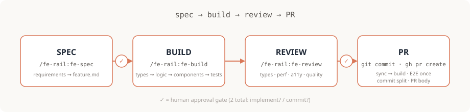

# fe-rail

<div align="right">
  <a href="README.ko.md"></a>
  <a href="README.md"></a>
  <a href="LICENSE"></a>
  <a href="https://github.com/sh5623/fe-rail/actions/workflows/eval.yml"></a>
  <a href="https://www.claudepluginhub.com/plugins/sh5623-fe-rail?ref=badge"></a>
</div>

> Frontend-focused Claude Code plugin
> Automated spec → build → review → PR workflow for Next.js App Router / Vite SPA (TanStack Router · React Router 7·8) + TypeScript, with Tailwind v3/v4 and shadcn/ui support.

## Installation

```bash
claude

/plugin marketplace add sh5623/fe-rail
/plugin install fe-rail@fe-rail-market
```

> Also using [self-improvement](https://github.com/sh5623/self-improvement)? Install both from one marketplace: [`sh5623/guardrail`](https://github.com/sh5623/guardrail).



## Usage

```
$ claude
> /fe-rail:fe-spec

[fe-spec] Analyzing requirements... (fe-analyst, fe-architect)
✔ feature.md generated: 7 sections, 3 open questions resolved

Next step?
  ❯ Full auto (recommended): hand off to fe-start automatically
    Build only: I'll review the spec first
    Revise spec

> Full auto

[fe-start] Phase 2: implementing types → hooks → components → tests
✔ 12 files created, tsc clean, lint clean, 8 tests passing

Commit and open a PR?
  ❯ Yes: sync with the base, run build + E2E once, then commit by type (feat/fix/test) and open a draft PR
    No: leave changes uncommitted

> Yes

✔ Synced with origin/main (2 upstream commits) · build passed · E2E passed
✔ 2 commits created
✔ Pushed to feat/product-search-autocomplete
✔ Draft PR: https://github.com/you/your-app/pull/42
```

You are asked two things, "Implement?" and "Commit?". Everything else runs unattended.

## Skills

| Skill | Command | Description |
|-------|---------|-------------|
| fe-spec | `/fe-rail:fe-spec` | Requirements → structured spec document. Phase 3 presents a radio UI to choose the next step (full auto · build only · revise spec); "full auto" hands off directly to the fe-start pipeline |
| fe-build | `/fe-rail:fe-build` | Frontend implementation (types → logic → components → tests by default; follows the repo's existing order or TDD) |
| fe-review | `/fe-rail:fe-review` | 4-axis code review: types · performance · a11y · quality |
| fe-start | `/fe-rail:fe-start feature.md` | All-in-one: automates through PR creation. Phases 1 and 5 use a radio UI to confirm implementation and commit intent |
| fe-doc-sync | `/fe-rail:fe-doc-sync` | Scans the **consumer project** (routes · deps · structure · ENV) → proposes updates to that project's CLAUDE.md · README.md |

## Hooks

Policy: block dangers (exit 2), warn on quality issues (stderr).

| Hook | Event | Role | Blocks |
|------|-------|------|--------|
| `session-init.sh` | SessionStart | Remote version check + new version notification (GitHub, once/day · off with `FE_RAIL_NO_UPDATE_CHECK=1`) | — |
| `guard.sh` | PreToolUse:Bash | Blocks `git add .`, force push, `--no-verify`, `rm -rf /`, `DROP TABLE`, `git reset --hard`, `git checkout/restore .`, etc. Git global options (`git -C <dir> …`, `-c k=v`, `--git-dir`) are normalized first and shell wrapping (`bash -c "git commit --no-verify …"`) is caught; the commit check uses a small shell-like parser: it splits the command on `;`, `|`, `&`, and newlines outside quotes (not on redirections such as `2>&1`), removes quotes from each word, reads the words the way git does, and blocks an `n` anywhere in a short-flag cluster (`-nm`, `"-n"`) or `--no-verify` (abbreviations included). Option values such as messages are never inspected, and an argument the parser cannot resolve (`$X`, `$'…'`, backticks, `{…}`) is blocked: when in doubt, block. A regex backstop for the common shapes, not a guarantee over arbitrary shell | ✅ |
| `write-guard.sh` | PreToolUse:Write\|Edit\|MultiEdit | Blocks creating/editing sensitive files: `.env*`, certificates (`*.pem`/`*.key`, etc.), secret-payload files (`*.secret`, `*credentials*.json`, etc.); source files such as `.env.example` or `CredentialForm.tsx` are still allowed | ✅ |
| `config-protection.sh` | PreToolUse:Write\|Edit\|MultiEdit | Blocks only **weakening** edits to linter/formatter/TS config: `strict:false`, `@ts-nocheck`, linter `recommended:false`, removing an existing `strict:true`. Judged on the whole file before vs. after the edit (reconstructed from disk plus the Edit/MultiEdit/Write payload), so a value-only `true → false` Edit and a Write that drops the `strict` key are caught too. Normal edits (path aliases, adding plugins, etc.) pass through | ✅ |
| `read-guard.sh` | PreToolUse:Read | Warns on sensitive file reads (`.env*`·`.envrc`, keys like `*.pem`/`*.key`/`id_rsa`, `.npmrc`·`*credential*`; the list mirrors write-guard's block list) | — |
| `task-guard.sh` | PreToolUse:Task\|Agent | Blocks injection patterns and dangerous command delegation in sub-agent prompts | ✅ |
| `lint-fix.sh` | PostToolUse:Edit\|Write\|MultiEdit | Auto-detects consumer env → runs Biome `check --write` **or** ESLint `--fix` (+ Prettier). Config and binaries are resolved from the file's nearest `package.json` (monorepo app-local setups), binaries also root-hoisted (local binary first; npx fallback is opt-in via `FE_RAIL_ALLOW_NPX=1`) | — |
| `nextjs-guard.sh` | PostToolUse:Edit\|Write\|MultiEdit | In App Router projects (`app/` present; Pages Router is skipped), flags React hooks/browser API/DOM events in files without `'use client'` as "check the import boundary" (a child imported only below a client boundary needs no directive; `next build` is the authority); warns when `page`/`layout` carries `'use client'` | — |
| `design-nudge.sh` | PostToolUse:Edit\|Write\|MultiEdit | Warns on generic/templated (AI-slop) signals in frontend edits (heavy or arbitrary shadows, default purple/indigo gradients). Silent if DESIGN.md exists, since fe-reviewer's DESIGN Bans is the source of truth in that case | — |
| `quality-gate.sh` | Stop | Runs the linter (Biome **or** ESLint) + type check on changed files and outputs warnings. It prefers the project's `typecheck` script, even without a root `tsconfig.json`, and falls back to `tsc -b` for solution-style tsconfig. Changed files are grouped by their nearest `package.json` and each package is checked with its own config (monorepo), binaries resolved app-local → root-hoisted. The type check is judged by exit code (no false positives from success banners). It also triggers on `tsconfig*.json`/`package.json` changes and on deleted sources, and the file scope is not silently capped (up to 200, the rest reported as unchecked) | — |
| `doc-sync-check.sh` | Stop | Detects changes to consumer project code / package.json / config files → suggests `/fe-rail:fe-doc-sync` (includes last 5 commits) | — |
| `test-verify-turn.sh` | UserPromptSubmit | Records the turn's starting state (HEAD plus a content hash per uncommitted file) per session inside `.git` (untracked). No output | — |
| `test-verify-stop.sh` | Stop | If this turn changed a unit test and related product source changed too, but nothing records that the test **actually fails on the pre-fix code**, blocks the stop once and asks for an `fe-rail verify-test` run. Stays silent when it can't tell (unknown runner or package relation) and only notifies on unverified combinations. See "Regression-test check" below | once |
| `notify.sh` | (Optional) Notification | macOS terminal-notifier banner; activate with `bash hooks/scripts/setup-notifier.sh` | — |

### Hook profiles & toggles (intensity control)

Hook intensity can be tuned via environment variables (no plugin file edits needed; set them in the consumer project's shell or `.claude` environment).

| Env var | Value | Effect |
|---|---|---|
| `FE_RAIL_HOOK_PROFILE` | `minimal` | Only the irreversible-risk blockers (`guard`, `write-guard`, `task-guard`, `config-protection`). Quality warnings, auto-cleanup, and doc-sync prompts are turned off |
| | `standard` (default) | The above + all quality warnings/auto-cleanup/doc-sync |
| | `strict` | One tier above `standard` (currently a superset, reserved for stricter behavior in the future) |
| `FE_RAIL_DISABLED_HOOKS` | `"a,b"` | Disable specific hooks by name (e.g. `"doc-sync-check,design-nudge"`) |
| `FE_RAIL_ALLOW_NPX` | `1` | Allow npx fallback when no local linter or `tsc` binary is present (default is local only, which keeps auto-hooks from downloading or running unpinned latest versions). Doesn't affect a project's own `typecheck` script, which always runs via the package manager |
| `FE_RAIL_ALLOW_PW_INSTALL` | `1` | Lets fe-start's Phase 6-0 (pre-commit) gate install Playwright browsers automatically (`playwright install --with-deps chromium`). Off by default: it is a several-hundred-MB download and `--with-deps` needs root, so an unattended pipeline shouldn't trigger it silently. While off, E2E is honestly reported as "not run (browsers missing)" rather than passed |
| `FE_RAIL_NO_UPDATE_CHECK` | `1` | Turns off the remote version check at session start (no lookup, no notice), for offline or locked-down networks |
| `FE_RAIL_SKIP_SETUP_NUDGE` | `1` | Turns off the one-time session notice shown when the recommended Bash permissions are missing |

> Downgrading the profile to `minimal` does not disable the safety blockers. To turn them off, name them explicitly in `FE_RAIL_DISABLED_HOOKS` (no-compromise blocking plus an explicit escape hatch). A non-default profile or a disabled-hooks list is announced at session start.
> The two regression-test-check hooks share the name `test-verify` (`FE_RAIL_DISABLED_HOOKS="test-verify"`). Limits and timeouts (`FE_RAIL_VERIFY_*`) are listed in [`docs/test-verify.md`](docs/test-verify.md) §7 (Korean).

## Regression-test check (test-verify)

Measures whether a newly written regression test **actually fails on the pre-fix code**. Re-running a passing test can't tell you whether it catches the defect; it has to go red when the fix is reverted. This plugin keeps that "revert" out of human and model hands.

```bash
fe-rail verify-test base -- src/price.test.ts                                     # pre-fix contrast (base = this session's turn-start HEAD)
fe-rail verify-test base --test "price > adds 10% tax" -- src/price.test.ts         # name the target case
fe-rail verify-test mutate --file src/price.ts --find "* 1.1" --replace "* 1.2" -- src/price.test.ts   # targeted mutation (new features)
fe-rail verify-test status -- src/price.test.ts                                   # is there a record covering the current state?
```

- **Changes happen only in isolated copies.** The current work (tracked plus non-ignored untracked files) is copied to a temp directory, `node_modules` is linked in entry by entry, and that copy is cloned so there are two. One keeps the current source; in the other only the product sources are swapped to their pre-fix contents (or the mutation). The same tests run in both. Your working tree and index are only read.
- **Verdicts are per test case.** Detected (passes now; in the contrast run that case's body assertion flipped) · Undetected · Unconfirmed (failed in a setup hook, a non-assertion error, or the failure location can't be told) · Unmeasurable (isolation failed, fails on the current source, the file failed to load, no baseline snapshot, …). Anything that can't be confirmed is not counted as detected.
- **It runs on its own.** The Stop hook blocks once when a unit test changed this turn with no matching record. fe-start checks the same record in Phase 4.5 and puts the result in the PR's `## Tests`. fe-test-author's `regression` mode and fe-reviewer's "test discriminating power" axis use it too.
- **Automatic blocking only for verified combinations**, the ones that pass the real-runner eval (`node eval/runner.mjs` installs pinned versions and actually runs them): npm/pnpm + Vitest 4 and 5, npm + Jest 30. Elsewhere you can still call the runner yourself and the hook only notifies. Yarn PnP isn't supported in this first release.
- **Project overrides** live under `"fe-rail": { "testVerify": { … } }` in `package.json`: the test command (`command`), a prepare command (`prepare`, for workspaces consumed as build output), extra git-ignored inputs to copy (`copy`), and classification paths.

Verdict criteria, the isolation self-checks, record reuse rules, support status, and how to read undetected or unconfirmed results are in [`docs/test-verify.md`](docs/test-verify.md) (Korean). The `fe-rail` command is on the PATH of Claude Code's Bash tool; in a plain shell or CI, run `node <install path>/bin/fe-rail.mjs …`.

### Regression eval

```bash
bash eval/run.sh   # exits 1 on failure (CI-ready)
```

It runs without a live model and verifies, deterministically:

- hook behavior, by injecting fixtures and asserting exit codes and warnings, including that block reasons go to stderr rather than stdout and that the 5 non-blocking hooks send their notices to stderr as well
- profile toggles
- plugin self-lint: agent `model` values within the valid set (the aliases `opus`/`sonnet`/`haiku`/`fable`/`inherit` or a full model ID); agent `effort` values within `low`/`medium`/`high`/`xhigh`/`max` where set, and never set on `haiku` agents, which do not support it; skill frontmatter; frontmatter plain scalars that stay YAML-safe (a value containing `: `, colon plus space, breaks parsing and silently drops the whole frontmatter, including `tools`, `disallowedTools`, and `model`); `hooks.json` integrity and profile wiring; delegating skills listing Task/Agent in allowed-tools; bun `PX` detection consistency; typecheck branches always pairing a `references` (`tsc -b`) fallback; and binary+flag invocations using `$PX` rather than `$PM exec`
- fe-start's default gate picker (`gate-commands.mjs`), pinned on 14 fixtures shaped like real consumer projects (single app, configs in subfolders, a workspace with an aggregate root script, decoy values such as `"workspaces": ["e2e"]`, bun, and more); needs node
- the session-init version check with a mocked `curl`: a notice for a newer version, silence with `FE_RAIL_NO_UPDATE_CHECK` or the same version, and the later notices still shown when the plugin path is missing
- the regression-test check (section H, `eval/test-verify.mjs`): with a fake-runner fixture it pins classification, isolated runs (working tree and index preserved, including staging by another process mid-run), verdicts, record reuse, and when the hook blocks or stays silent; real Vitest 4.1.9 and Jest 30.2.0 report samples pin the verdict boundaries (no dependency install)

It exists to catch regressions when alias tiers shift with model updates, or when hooks and config change.

The real-runner eval runs separately. It installs a pinned version for every verified combination and actually runs it, so it needs the network and takes two to three minutes. CI runs it on every push.

```bash
node eval/runner.mjs                      # every verified combination (npm/pnpm × Vitest 4.1.9 · 5.1.0, npm × Jest 30.2.0); fails if a tool is missing
node eval/runner.mjs --only npm-vitest-4  # one combination
```

v1.17.0 added section F. A cross-repo review reproduced twelve findings against v1.16.2 in throwaway repos, and each one is now a pinned regression: git global options and shell wrapping reaching the guard, config protection judged on the whole file before and after the edit, every `hooks.json` command executed from an install path containing a space, monorepo app-local and root-hoisted tools actually being called, `typecheck` running without a root `tsconfig.json`, deleted sources triggering the type check, all 21 of 21 changed files reaching the linter, the `git commit --only` isolation contract, and self-lint for agent scope (tracked ∪ untracked), exit-code preservation, `$PM run test`, the verification-result contract, and push ownership. When `ruby` or the `claude` CLI is present it also parses every frontmatter with a real YAML parser and runs `claude plugin validate --strict`.

v1.18.0 makes the framework rules reachable. `docs/framework-rules.md` and `docs/monorepo.md` used to be referenced only by this repo's own `CLAUDE.md` `@import`, which a consumer session never loads, so no agent ever saw them. Now the fe-build, fe-review, fe-start, and fe-spec skills read the relevant section (common rules plus the detected framework) through the skill base directory and pass the absolute path to the agents they delegate to (`fe-architect`, `fe-reviewer`, `fe-build-fixer`, `fe-perf-auditor`). If no path arrives, an agent falls back to a plugin-cache glob, and if that finds nothing it says "rules file not received" on the first line of its report. The repo's own `CLAUDE.md` moved to `.claude/CLAUDE.md` for the same reason: a root `CLAUDE.md` ships in the plugin tree without being loaded, which is exactly what `claude plugin validate --strict` warns about. The eval now requires `--strict` to pass with zero warnings and self-lints both the absence of a root file and the rules wiring.

v1.19.0 moves fe-start's build and E2E from before "Commit?" (Phase 4.5) to right before the commit (Phase 6-0); see Workflow below. The eval checks that the build/E2E block lives only in 6-0 and not in Phase 4.5, that 6-0 comes before 6-1, and pins one git contract: `git rebase --autostash` exits 0 even when re-applying the uncommitted changes conflicts, so a sync conflict has to be detected with `git diff --diff-filter=U` (fe-git-operator sync mode).

v1.19.1 fixes three things a cross-check reproduced. The pre-commit gate result is now chained to the commit **only when the commit tree equals the tree that was checked**: a check that passed on a working tree mixed with out-of-scope changes could fail on the commit that holds only the scoped files. So Phase 6-0 first stops and asks when out-of-scope changes are present. The verification fingerprint moves from a hash of `git diff HEAD` to a "verified tree id" built in a temporary index, so edits to untracked files count too. Sync mode no longer rebases while changes are staged (autostash would unstage them). The eval pulls the snippets out of the docs and runs them in throwaway repositories.

v1.20.0 changes how fe-start picks its default pre-commit commands, for projects that don't declare their own gate. The choice moves out of the skill text into `skills/fe-start/scripts/gate-commands.mjs`, which only picks and never runs anything. It reads `package.json` and checks `scripts` keys instead of grepping the whole file: root scripts first (`build`; `e2e`, then `test:e2e`), then every workspace package that has one, then a root `playwright.config.*` with `@playwright/test` installed. Anything else is reported as not run, with any nested Playwright configs named in the reason. The old grep missed `test:e2e` and fell back to a bare `playwright test`. In a single app whose configs live under subfolders, that run loaded the unit test files and failed, which sent the gate into the fix loop. A `"workspaces": ["e2e"]` entry could also make it call a script that didn't exist. The eval now pins the picker on fixtures shaped like real consumer projects. Two smaller fixes come with it. fe-vision returns `verdict: "unverified"` with no score when an input is missing, and fe-start sends only `revise` into the fix loop, so an unjudged screen is no longer treated as a score of 0. fe-pr-author now detects the remote host: GitHub uses `gh pr create`, CodeCommit uses `aws codecommit create-pull-request`, and any other host stops and reports. The session version check can be turned off with `FE_RAIL_NO_UPDATE_CHECK=1`, and when the plugin path is missing it no longer skips the notices that follow it. The completion criteria now take lint pass/fail from the project's own command and viewports from what the screen supports, and fe-build's implementation order and "propose two variants" rule now give way to the repo's existing patterns.

v1.21.0 adds the regression-test check (section above): the `fe-rail verify-test` runner, the turn-start and Stop hooks, fe-test-author's `regression` mode, fe-reviewer's "test discriminating power" axis, and the link from fe-start Phase 4.5 to the PR's `## Tests`. The design went through four rounds of external review, and every pitfall those rounds reproduced is now a pinned regression. Swapping files in the working tree and restoring them is out: if another process stages in between, the index can change even though the file hashes match after restore. Reusing one copy is out too, because a state file left by the first run can flip the second run's result on identical source, so two clean copies are used. Linking an `@scope` directory whole lets workspace packages resolve back to the original, so the final resolved path is checked. A package that exports build output keeps serving its old output even after the contrast source changes. With default settings, snapshots get written fresh in each copy and both pass. A failing `afterAll` leaves the case marked "passed" in the case table. Verdicts are per named case rather than per file, and an assertion error raised in a setup hook is not a detection. While building the real-runner eval we found pnpm 11 trying to run `install` by itself inside a copy, so the runner turns off the pre-run dependency check for every command it runs in a copy.

v1.21.1 closes an isolation gap found by a security review right after v1.21.0. The copies keep the repository's symbolic links as links, so writing the pre-fix content (or a mutation) into the second copy could follow a link out of the copy, onto the original file it points to. The runner now refuses to write when any existing segment of the target path inside the copy is a link, and reports "unmeasurable" instead; a source that was a link in the base revision is not contrasted either. The same guard covers copying declared extra inputs. The eval pins both cases and was checked to fail with the guard removed.

v1.21.2 fixes the commit-hook bypass rule in `guard.sh`. The old regex let `.*` after `git commit` run across command boundaries, so a later command's `-n` (`git commit -m x && sed -n 1p f`, `…; head -n 5 log`, `… | cat -n`) was read as a commit flag and blocked. In the other direction, `git commit -nm "wip"` and `-anm`, where `n` sits inside a short-flag cluster, got through. The command is now split into pieces and only the arguments after `git commit` in its own piece are checked; `n` is caught anywhere in a short-flag cluster, and message values are also stripped from combined forms such as `-qm` and `-am`. Lines continued with a trailing `\` are joined first, so a `-n` on the next line can't slip out. The eval gains 20 cases (11 that must pass, 9 that must be blocked); the old rule gets 11 of them wrong.

v1.21.3 redoes the v1.21.2 guard fix. A security review found new bypasses in v1.21.2's per-piece regex: it also split on `;` and `&` inside quotes and redirections, so the `-n` in `git commit --author="a;b" -n` or `git commit 2>&1 -n` landed in another piece, and it looked only after the last `git commit` in a piece, so `git commit -n -m x # git commit` got through. Quoted flags (`"-n"`, `-nm"wip"`) and the abbreviation `--no-veri` had always slipped through. A small awk parser now replaces the regex: it splits pieces only outside quotes, removes quotes from each word, and reads the words the way git reads options (a value-taking option consumes its value, so `-mn` is the message "n"). A word that contains spaces plus `git` and `commit`, as in `bash -c "…"`, is parsed again. The eval gains the 19 cases from the review.

v1.21.4 hardens the v1.21.3 parser after a second security review, on the rule "when in doubt, block". The shell can turn `$'-n'`, `"$FLAG"`, `{-n,}`, or a backtick substitution into `-n`, and the parser cannot know the value, so it let them through. Now an unresolvable expansion in an argument position that is not an option value (the first character of a word, a flag position in a short cluster, or a long option name) is blocked; values such as `-m "$MSG"` and `--author="$A"`, and pathspecs after `--`, are not inspected. Git global options with attached values (`git -Crepo commit -n`) are skipped before looking for `commit`, pieces are not split on `;` inside parentheses (`(`, `$(`, `<(`) or backticks, and more than 16 words to parse again is blocked (skipping the rest would be a bypass). The eval gains 28 cases; the first edition (1.21.1) gets 32 of the 74 cases so far wrong.

## Agents

Each agent runs in an isolated context, protecting the main session from noise.
Structure: frontmatter (`tools`/`disallowedTools`/`model`/`maxTurns`) + XML tags (`<purpose>`/`<forbidden>`/`<required>`/`<workflow>`/`<output>`).

> **Model tiers are aliases.** Each agent's `model` is set to `opus`/`sonnet`/`haiku`, so on the Anthropic API it picks up the latest tier automatically when a model family updates (e.g. Opus 4.8 → Opus 5); there the aliases resolve to Opus 5 · Sonnet 5 · Haiku 4.5 (verified 2026-07). On Claude Platform on AWS, Amazon Bedrock, Google Cloud, or Microsoft Foundry, the same alias resolves to an older generation. As of the same date: Claude Platform on AWS `sonnet`=Sonnet 4.6, Amazon Bedrock / Google Cloud `sonnet`=Sonnet 4.5, Microsoft Foundry `opus`=Opus 4.6 and `sonnet`=Sonnet 4.5. Check Claude Code's model-config docs for your provider's exact resolution. Behavior may vary even with the same plugin version; run regression checks on each release if reproducibility matters.
> Tier allocation: **opus** (high-judgment: `fe-analyst` · `fe-architect` · `fe-reviewer` · `fe-refactor-advisor`) / **haiku** (low-cost exploration: `fe-explorer`) / **sonnet** (all other execution/tool agents).
> **Effort is pinned per agent, not inherited from the session.** Otherwise a consumer running `/effort max` would push every fe-rail subagent to max. `high` for judgment gates and precision audits, `xhigh` for code-writing loops (`fe-build-fixer`, `fe-test-author`), `medium` for mechanical tool/research agents; `fe-explorer` (haiku) has none set, since Haiku doesn't support effort. `xhigh` requires Sonnet 5 or Opus 4.7 and later; on third-party providers where `sonnet` still resolves to 4.5/4.6, drop `fe-build-fixer` · `fe-test-author` to `high` if you hit an effort-related error.

### Spec stage
| Agent | When to delegate | Model | Isolation |
|-------|-----------------|-------|-----------|
| `fe-analyst` | Requirements gap analysis (6 gaps / 7 sections); parallel scan of CLAUDE.md · DESIGN.md · PRODUCT.md · AGENTS.md | opus | Scoped (read-only) |
| `fe-deck-reader` | PPT/deck decomposition: breaks multi-slide specs into policies · screens · flows (via PDF/PNG conversion) | sonnet | Scoped (read-only) |
| `fe-vision` | (Extract) Figma · UI screenshots · PDF · PPT (via conversion) per-screen analysis (Figma URL → `get_metadata` · `get_design_context` · `get_variable_defs` · `get_screenshot`; DESIGN.md Bans anti-slop check) · (Contrast) implementation screenshot ↔ reference visual fidelity judgment (visual-verdict; Figma=pixel/PPT=layout; missing input → `unverified`, never a score of 0; fe-start Phase 4.5) | sonnet | Scoped (read-only) |
| `fe-researcher` | External docs · library research (Context7 MCP preferred, WebSearch/WebFetch fallback) | sonnet | Tool (Context7/WebSearch/WebFetch) |
| `fe-architect` | React/TS architecture: Next.js (RSC boundaries) / Vite SPA (TanStack Router · React Router 7·8 · Zustand) + Tailwind v3/v4 · shadcn · openapi-fetch (orthogonal detection) | opus | Scoped (read-only) |

### Build stage
| Agent | When to delegate | Model | Isolation |
|-------|-----------------|-------|-----------|
| `fe-explorer` | Codebase exploration (3+ queries) | haiku | Context |
| `fe-test-author` | BDD scenario derivation + TDD Red-Green-Refactor · `regression` mode (checks with `fe-rail verify-test` that a regression test written with a fix fails on the pre-fix code; never reverts by hand) | sonnet | Scoped (implementation) |
| `fe-build-fixer` | tsc · linter (ESLint/Biome) error fixes with minimal diff | sonnet | Tool (Edit+Grep, Write/MultiEdit blocked) |

### Review stage
| Agent | When to delegate | Model | Isolation |
|-------|-----------------|-------|-----------|
| `fe-reviewer` | 4-axis review (type · performance · a11y · quality). The performance axis also covers React hook runtime bugs such as missing cleanup, async races, and infinite loops, and the review checks Tailwind anti-patterns, openapi-fetch patterns, and the DESIGN.md design contract when present. When test files change it also checks test discriminating power (assertions opposite to the title, assertions that can't fail, multi-argument negated assertions, `[0]` slipping to a sibling, undetected records), never raised to BLOCK | opus | Scoped (read-only) |
| `fe-a11y-auditor` | 8-axis a11y audit (color contrast included, Tailwind palette based). `--live` runs a real Lighthouse a11y audit + accessibility-tree snapshot via Chrome DevTools MCP when installed; static-only otherwise | sonnet | Scoped (read-only) |
| `fe-perf-auditor` | Performance audit: Next.js (RSC · next/image · next/font) / Vite SPA (TanStack loader · RR7·8 TQ prefetch · fetchpriority · bundle) / Tailwind v3/v4 (purge · @source · @apply). `--live` runs a real dev-server measurement (LCP breakdown, console, network) via Chrome DevTools MCP when installed; static-only otherwise | sonnet | Scoped (read-only) |
| `fe-test-runner` | Test execution + failure classification | sonnet | Context |
| `fe-refactor-advisor` | 6-dimension refactoring analysis + Before/After | opus | Scoped (read-only) |

### PR stage
| Agent | When to delegate | Model | Isolation |
|-------|-----------------|-------|-----------|
| `fe-git-operator` | Commit splitting · staging that leaves your pre-staged index alone (`git commit --only -- <files>`) + body authoring (fix = symptom·cause·fix / feat = added·core·impact) · owns `git push` | sonnet | Tool (Write/Edit blocked) |
| `fe-pr-author` | PR body authoring (🐛/✨ blocks by change type + risk-ordered review points) from the verification-result object (the test checklist records exit code @ SHA and never says "passed" by assumption) + PR creation after detecting the remote host (GitHub `gh pr create` / CodeCommit `aws codecommit create-pull-request` / other hosts stop and report; pushes only as a fallback when the branch has no upstream) | sonnet | Context + Tool |

## Workflow

**All-in-one automation (fe-start)**
```
Write feature.md → /fe-rail:fe-start feature.md → [radio] "Implement?" → [radio] "Commit?" → base sync + build · E2E once → commit · push → PR created
```

> If the same item still isn't resolved after 3 re-delegation attempts, an extra STOP can trigger: automation pauses and reports a diagnosis instead of looping indefinitely. A conflict during the pre-commit base sync stops the same way.

Heavy gates such as build and E2E run after you approve "Commit?", right before the commit, not before the question (v1.19.0). "Commit?" is where you look at the change locally and ask for fixes, so a build or E2E run made before it is thrown away by the next fix or by one new upstream commit. Before "Commit?" fe-start runs only the full type check, lint and unit tests (plus visual fidelity for reference-matched screens). After you approve, it brings the working tree up to date with the branch it will land on (fetch, then fast-forward or rebase) and runs build and E2E once on that tree. Asking for fixes any number of times still means one heavy run. If your project has its own pre-push gate (a change-aware E2E runner, say), declare the command in your CLAUDE.md or AGENTS.md; otherwise fe-start runs the full build and the full E2E suite, picking the commands from `package.json` scripts (the root script, then every workspace package that has one, then a root Playwright config). The "Commit?" report also attaches, to each interaction the spec changes, the test or observation that confirms it.

**fe-spec → full-auto handoff**
```
/fe-rail:fe-spec → [radio] select "Full auto" → fe-start runs automatically → [radio] "Commit?" → PR created
```
> Selecting "Full auto" at fe-spec's "next step" gate counts as the first approval ("Implement?"), so fe-start only asks "Commit?", and two human approvals are still preserved overall.

**Step-by-step manual control**
```
/fe-rail:fe-spec → /fe-rail:fe-build → /fe-rail:fe-review → git commit && gh pr create
```

## Prerequisites

- Claude Code
- Node.js 20+ (regression-test check runner, hooks, fe-start default gate picker)
- Package manager (pnpm / npm / yarn / bun, auto-detected from the lockfile)
- gh CLI (for automated PR creation)
- TypeScript strict mode (Next.js / Vite SPA)

## Post-install Recommended Setup (Consumer Project)

Plugin agents read and reason from the consumer project's context. Setting these up right after installation makes a large difference to output quality.

| Item | Why | How |
|------|-----|-----|
| **Project CLAUDE.md** | `fe-analyst` · `fe-architect`, etc. read the stack · rules · constraints from it; without it, agents analyze blind (this repo's own `.claude/CLAUDE.md` is not loaded into consumer sessions; the framework rules in `docs/` reach agents only through the skills, see v1.18.0 above) | `/init` or `/fe-rail:fe-doc-sync` |
| **Bash permissions** | Prevents a permission prompt on every `fe-git-operator` · `fe-pr-author` action | Auto: run `bash <install-path>/hooks/scripts/setup-permissions.sh` from the project root (detects host → merges into `.claude/settings.local.json`, confirm once) · Manual: add `Bash(git *)` · `Bash(gh pr *)` to `permissions.allow` in `.claude/settings.json` |
| **MCP (optional)** | Enables `fe-vision`'s direct Figma lookups, `fe-researcher`'s Context7 doc queries, and `fe-perf-auditor`/`fe-a11y-auditor`'s live measurement via `--live` (falls back to local images / WebSearch / static analysis if not installed) | Figma: claude.ai connector (`/mcp` → "claude.ai Figma", OAuth) · Context7: install the plugin · Chrome DevTools: install the plugin. If not installed, each agent falls back and surfaces the enable command just-in-time (JIT) |
| **Validation scripts** | Phases 3 and 4.5 use `typecheck`/`lint`/`test`; the Phase 6-0 pre-commit gate uses `build`/`e2e` if present | Define those scripts. If your project has its own pre-push gate, declare the command in CLAUDE.md or AGENTS.md |
| **Regression-test check declaration (optional)** | If tests need environment variables, a workspace package is consumed as build output, or tests need git-ignored files, auto-detection alone ends in "unmeasurable" | `"fe-rail": { "testVerify": { "command" · "prepare" · "copy" } }` in `package.json`; see [`docs/test-verify.md`](docs/test-verify.md) §7 |

## License

[MIT](LICENSE) © 2026 이승호

## References

- [addyosmani/agent-skills](https://github.com/addyosmani/agent-skills)
- [Chachamaru127/claude-code-harness](https://github.com/Chachamaru127/claude-code-harness)
- [garrytan/gstack](https://github.com/garrytan/gstack)
